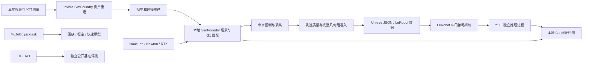

# SIM 项目盘点与投入建议

日期：2026-10-08。范围：`/home/user/Documents/zoo/sim`。

这是基于当前目录、代表性源码、README、交接记录、已保存实验结果的静态评审，不是重新运行后的性能认证。根目录 SimFoundry 最新交接内容到 10 月 5 日；旧抓杯结果来自 7 月历史笔记，未在本机重跑。本文建议未执行代码迁移、清理、训练或采集；已有暂停状态保持。

评估假设：近期核心目标是 G1 固定工位分拣及可信的数据/评测闭环。如果商业目标是资产生成服务，Real2Sim 的优先级应提高；当前没有客户需求、团队规模和实际工时账本，因此以下是技术投入判断，不是财务 ROI 结论。

## 1. 结论

保留 G1 分拣作为有条件投入的主线，但停止以“继续扩采/延长训练”为默认动作。先把接触控制、数据协议、评测三个模块做稳定，再扩大模型训练。

值得继续：统一评测、数据转换与来源追踪、G1 标定/接口、受控接触实验、任务相关资产生成。

停止当前配方：short_first40 替代基线、抓杯 residual PPO v1/v2 延长训练、同一窄分布盲目扩采、在固定几何上持续叠加缺少可归因收益的补丁。

冻结为演示/研究资料：家庭场景扩张、七分区任务展示、缺少实际任务需求的抓杯/拎包扩展。保留其中可复用组件。

IsaacLab 按上游基础设施维护，dist 按交付快照维护，数据目录和历史压缩包不算独立研发项目。

## 2. 项目目标、架构、应用与决策

| 工程/子项目 | 目标及架构 | 当前应用与证据 | 建议 |
|---|---|---|---|
| `IsaacLab/` | Isaac Lab 环境/机器人/传感器接口，连接 Newton 或 Isaac Sim PhysX、RTX 渲染、RL 工具 | 本地 G1 环境底座；根 README 有 Cartpole/Ant 冒烟记录，不代表分拣性能 | 保留、锁版本、控制本地补丁；不另起通用仿真框架开发 |
| `SimFoundry/` 分拣主线 | 场景包→G1 23D 仿真→专家轨迹→质量审核→Unitree/LeRobot 数据→π0.5→RPC 闭环 | 最接近当前 G1 分拣需求；已有训练和多布局失败证据，尚未证明稳定泛化 | 主线保留，拆模块，限定实验预算 |
| `SimFoundry/` 厨房/室内演示 | 独立 scene package、Isaac env、脚本控制及头部相机 | 原型演示与场景接口验证；不能由演示推出通用技能学会 | 冻结场景扩张，保留 scene bridge |
| `nvidia/SimFoundry/` | 视频→深度/分割→网格/位姿→物理编译→USD/OmniGibson；A 重建、B 增广、C 应用 | 本地实际用作包裹、帽、瓶、毛巾资产制作和静物预览；已有部分包裹外观接入本地 Isaac | 保留为资产供应工具；按任务需要投入 |
| `lerobot/` 训练与数据工作区 | 多批 v3 数据、基础权重、输出；复现包内 vendored LeRobot 提供模型实现 | 支撑分拣训练；`lerobot_v3.0` 是 293 条统一数据，不是框架源码根目录 | 整理为数据、模型、训练适配三类职责 |
| `lerobot/unitree_lerobot_yth_repro_20260908/` | G1 数据转换、模型训练/推理、机器人接口及历史模型记录 | 可复用协议和真机适配；资料包缺完整数据/权重/部分外部推理入口和网格 | 提取需要的适配模块，不把复现包视为完整可部署产品 |
| `picktask-sim/picktask/` | MuJoCo G1 固定骨盆，scripted/teleop→LeRobot v3→ACT→可选 residual PPO | 抓杯/拎包演示、低成本控制原型；历史 ACT 成功率低，残差版退化 | 冻结整条训练路线；保留 teleop、录制和分阶段诊断 |
| `picktask-sim/qk_validate/` | LeRobot v3 6D 倒水数据→关节映射→MuJoCo 回放→真仿叠图 | 适合动作映射、相机和时间对齐诊断 | 值得拆出为校准/回放工具 |
| `picktask-sim/home_scene/` | HomeSpec→RoomSpec→Workstation→SceneLayout；固定骨盆、工位切换 | 家庭场景和交互演示；工位瞬移不是行走策略 | 冻结；有具体客户或任务再恢复 |
| `evaluate/` | 官方 LIBERO BDDL/初态→OffScreenRenderEnv→策略适配→成功判定/录像 | 已跑零动作环境冒烟，尚无已训练策略排行榜 | 优先完善为独立评测模块 |
| `dist/` | 指定机器的源码+wheelhouse+安装与校验脚本 | 历史离线数据处理交付包；文档明确不能直接运行目标机 Isaac 闭环 | 仅做可复现发布，不形成第二源码主线 |
| `example_scene/`、`pic/`、`smoke_logs/`、压缩包、`.code-backup/` | 占位/素材/运行记录/备份 | 本次查看 `example_scene/sorting` 为空 | 建清单和保留策略；无需研发预算 |

## 3. 真实技术关系

图中资产接入已有部分实现；统一模块边界是建议，不代表各分支已自动打通。LIBERO 的动作空间/机器人协议与 G1 不同，不能把 G1 11D checkpoint 直接接进去，须有适配且具备对应任务训练能力的策略。

当前分拣状态是 11D 左臂5+右臂5+腰yaw；底层保留23D。历史 README 仍描述通用 v2.1、23D 和 `observation.images.d435i`，当前 π0.5 server 使用11D及 `observation.images.color_0`。旧通用导出和当前训练是不同接口层，不能直接用旧 README 代表实际训练合同。

仿真与推理解耦成不同 Python 进程，通过本地 TCP 传图像、状态、指令并返回动作序列。现有 `pi05_rpc.py` / `pi05_policy_server.py` 使用长度前缀和 pickle，默认回环地址。该接口适合当前可信本机进程；若产品化为跨机器服务，应另行定义版本、数组格式、超时及重置语义。

## 4. 影响去留决策的证据

### 4.1 当前 IDE 的 0918 summary 不是泛化验收

`preview_pi05_sorting_vla_0918_300_fair_r3/summary.json` 仅有 `box_only`、`mailer_only`、`wait_empty` 三种演示。单物体任务把另一物体放到 `(6,6)`，不构成双物体干扰测试。

盒的 Y 位移约 −6.91cm，袋约 +8.71cm，说明发生推动；touches 次数及位移均不能独立证明进入目标区、满足原质量门或完成任务。该文件没有完整泛化成功率。

### 4.2 short_first 新模型不应替代旧基线

同6布局、2推动任务、3推理seed加等待的历史锁腰协议，旧 coverage80 相对动作模型22/39，新 short_first40为7/39。只看推动，旧19/36、新4/36。局部320帧推动对照旧4/12、新3/12，不能用“把时间加长”解释全部退化。

已证实的新训练数据变化包括：横向跨度约15.8cm缩到3.12cm、单条更长但独立轨迹更少、外观组合单一、等待占比下降、相同prefix权重下实际起步曝光下降。它们共同变化，不能武断指定单一原因。

结论：关闭这次候选作为主模型的路线，保留负结果与局部专家价值；恢复后只允许明确控制变量的新假设。上述39条不是39个独立几何样本，三个seed是推理seed，每模型仅一个训练seed。

证据：[项目复盘](SimFoundry/PROJECT_REVIEW_20260929.md)、[空间39](SimFoundry/demo/short_first_model40_20260929_r1/SPATIAL39_RESULT.md)、[局部推动](SimFoundry/demo/short_first_model40_20260929_r1/LOCAL_PUSH_RESULT.md)。

### 4.3 允许腰转动后的瓶颈仍在合格示范生产

10月5日暂停记录中，新 normal 实验仅完成2个条件，52项审核完成、0项失败，但 `training_ready=false`；effective 实验采集完成10个条件，116项审核完成、2项失败，同样不能训练。已完成的物理结果曾从父版本6/8推动变成5/8，完整合格组仍为0。

“离线求解/KKT/命令恒等检查通过”“一条专家推动通过”“完整组准入”“模型学会”是四种不同证据。大量审计成功不能替代最终任务指标。腰转动后还出现头部相机目标出画问题，应与接触、避障共同研究。

结论：先把接触控制当一个有边界的控制研究模块，别继续把所有工作称作 VLA 训练进展。当前证据不支持立即恢复大规模扩采。

证据：[最新交接](SimFoundry/handoff.md)、[明确暂停记录](SimFoundry/demo/waist_enabled_20260929_r1/USER_PAUSE_20261005.json)、[协议约束](SimFoundry/PROJECT_CONSTRAINTS.md)。

### 4.4 抓杯 residual 路线应停止当前配方

历史相同30场景对照：纯ACT标准成功4/30，residual v2的best/final均0/30；v1也未优于基线。减小残差后仍破坏保持阶段，没有继续加长同配方训练的依据。

源码 `picktask/lib/pickcup.py:update_grasp` 存在满足条件后按手部锚点直接更新杯位姿的吸附机制。该机制下的任务成绩不能直接当作真实夹持力学或真实G1抓杯能力证据。固定骨盆、夹爪抽象与主线U1固定手也是不同机器人设定。

结论：保留交互、数据、回放和细粒度评测；冻结 residual v1/v2和单纯ACT续训。若抓杯成为独立业务目标，先确认真实手型与接触模型，再定义新的研究计划。

证据：[残差对照](picktask-sim/picktask/rl_granular_eval_v2_30ep_notes.md)、[ACT分层结果](picktask-sim/picktask/act_granular_eval_30ep_notes.md)。本次未找到并重跑历史模型，以上数字按保存笔记引用。

### 4.5 Real2Sim 有明确资产价值，但物理可信度有限

本地9个包裹采用尺寸规则几何和照片贴图；帽瓶经历剪假桌、重设尺寸、凸包碰撞；三巾使用照片扁盒，冻结在某种形态。除料箱外多项尺寸仍是估计，帽瓶巾尚未接入本地 G1 场景。

这说明已有可用的资产加工流程，也说明不能用视觉相似度替代质量、摩擦、形变和碰撞标定。暂不投入“任意视频全自动生成可训练物理世界”的宽目标。优先解决当前任务确实需要的资产契约和检验。

证据：[nvidia交接](nvidia/handoff.md)、[上游工具说明](nvidia/SimFoundry/README.md)。

## 5. 各项目待办、风险和继续条件

| 项目 | 最值得做的待办 | 主要风险 | 下一步完成判据 |
|---|---|---|---|
| IsaacLab | 固定当前可用版本/补丁/后端，保存环境锁及最小回归命令 | develop漂移、多Python/CUDA环境、文档中的旧启动故障 | 另一干净环境能重现规定场景冒烟；升级不改变既有协议 |
| 本地SimFoundry | 汇总暂停实验最终状态；冻结可复现基线；整理接触控制边界；建立未调参布局 | 窄分布、补丁相互抵消、目标出画、完整组0通过、无真机迁移证据 | 当前完整组原门通过后才准入；新模型在同预算未调参集逐类报告且不退化 |
| nvidia资产线 | 实测关键尺寸；统一visual/collision/单位/姿态；单资产静态稳定及接触检验 | 假桌伪几何、刚体冒充软袋/毛巾、环境和模型依赖重 | 一个版本化资产可独立导入本地Isaac，尺寸/碰撞/接触行为有证据 |
| LeRobot训练线 | 把数据、源码、模型分开索引；固定11D顺序/相对绝对动作/频率/相机key；保存训练专用统计 | v2.1/v3混用、多源码副本、SIM外环境、历史分数混协议 | checkpoint能追溯dataset、split、stats、代码、环境、训练/推理seed和评测协议 |
| Unitree复现包 | 列出真正使用模块与缺失依赖；补可移植配置和离线dry-run | 外部入口缺失，模型记录非本机验证，6D/11D/手型不同 | 不连机器人也能完成指定输入的预处理/推理/动作语义检查 |
| picktask抓杯 | 固定历史结果；注明吸附机制；提取录制与诊断 | 低成功率、保持失败、仿真机制与实机差异 | 无独立业务目标则归档；有目标则先重建真实手型/接触基线 |
| qk_validate | 参数化路径、关节映射、相机标定与时间同步 | 视觉叠图误差混入时延/内外参/坐标误差 | 已知轨迹能区分映射、时间和投影误差，不把回放叫闭环 |
| home_scene/室内演示 | 留固定可运行demo，说明移动和任务实现方式 | 场景扩张消耗精力，脚本展示与能力混淆 | 有具体任务需求及验收协议才恢复研发 |
| evaluate | 接一套与LIBERO匹配的真实策略；固定初态/预算/预处理；记录每episode失败 | 当前仅dummy；G1动作不能直接复用；公开基准与业务任务不同 | 可重复的真实模型闭环结果及失败视频，环境失败与策略失败分开 |
| dist | 写清源码版本、能力边界、清单校验、外部依赖；按目标机做验收 | 旧源码副本被当当前版本；能安装被当能仿真 | 目标机器完成其声明能力的命令清单；不宣称支持未验证的仿真 |

这里的继续条件是建议的研发门，不修改项目原有阈值。最终业务成功率需另行明确，不能以超过22/39就认定交付。

## 6. 建议拆出的模块

先在一个受版本管理的主工程中建立清晰包边界，再考虑分仓；不立即制造六套发布流程。

| 模块 | 输入→输出/职责 | 现有来源 | 优先级 |
|---|---|---|---|
| 机器人与标定 | URDF、关节合同、相机标定→统一state/action映射及仿真配置 | `robots/`、`calibration/`、Unitree适配、qk回放 | P0 |
| 数据与来源追踪 | raw episode→审核/完整组划分→Unitree/LeRobot→训练专用统计及manifest | `simfoundry/data`、转换/审计脚本、LeRobot元数据 | P0 |
| 评测协议与报告 | policy adapter+冻结任务集→分任务/布局/seed结果和失败证据 | 本地paired/spatial协议、`evaluate/`、picktask分层诊断 | P0 |
| 接触控制与专家 | 实测状态/接触→接近、加载、推进、恢复→最终关节命令 | bounded IK、waist coordination、contact load、recontact及已验证候选 | P0 |
| 场景与资产桥 | 资产manifest+layout→Isaac/OmniGibson消费层 | scene package、scene_bridge、nvidia library | P1 |
| 策略运行时 | RGB+状态+指令+会话→动作序列/延迟/失败 | π0.5 server/RPC、Unitree推理适配 | P1 |

接触控制需明确统一命令流水线及提交点：任务意图→约束求解→最终动作检查→执行→历史更新。已出现优化后处理使任务方向反转的记录，不宜继续通过越来越多顺序补丁隐式解决。

专家可用的物体真值、接触力与模型部署时可观测量要分别标记；若以后给策略加入这些传感输入，需要单独定义新接口和协议，不能把专家观测能力默认算到RGB策略上。

评测模块可共享调度、manifest与报告格式；各后端的动作语义、任务成功判据必须保留独立适配，不能一刀切统一成功定义。

## 7. 工程治理风险

- **源码来源分散。** 本地根目录、SimFoundry、lerobot未发现独立 `.git` 目录；nvidia树和picktask有独立仓库。此检查不排除上级仓库管理，应确认真正的版本归属并冻结当前基线。
- **实验代码与产物混存。** `SimFoundry/scripts`扫描有258个Python/Markdown/Shell文件；腰部实验目录递归扫描约6.3万条`.py`路径，包含大量冻结副本，不能理解成独立原创模块数。说明应建立统一实验登记和可定位的生产入口；不主张删除审计证据。
- **文档入口过时。** handoff约7825行，标题更新时间与最新条目不同；README的23D/v2.1与当前11D/v3路径须区分。新增简短CURRENT_STATUS和机器可读实验索引比继续增加流水账更有价值。
- **可复现依赖在目录外。** 训练脚本存在 `/home/user/Desktop/project/vla/env/.venv/bin/python` 等绝对路径，仅复制SIM不保证复现。
- **证据等级容易混淆。** 零动作环境冒烟、专家门通过、模型闭环成功、独立布局泛化、真机验证需独立标注。
- **数据留存边界。** 既有瘦身记录指出部分历史raw移除了RGB，只能用于数值证据，不能重新当完整训练集。清单必须写明可训练/可回放/仅供审计。
- **评价污染。** 已反复调参的布局属于回归/开发集；新最终测试应冻结且避免反复用来选择候选。

## 8. 推荐推进顺序与停止规则

1. **先整理、后恢复计算。** 建项目索引、当前基线清单、协议版本表、暂停实验登记和环境来源；保持10月5日暂停。此次盘点不是恢复授权。
2. **先收敛接触控制。** 从已有失败里挑明确假设，例如前袋加载保持、后处理任务方向一致性；限定开发几何、比较父版本，并保留原质量门和失败。静态检查通过后再做原完整条件物理对照。
3. **只有完整合格几何组才扩采。** 保留已有合格覆盖；按类别位置解耦、几何组划分；统计独立几何而不是只报帧数或episode总数。
4. **数据合格后单变量训练。** 一次只比较起步曝光或新增覆盖等一个假设；冻结模型/预算。先开发验证，候选有收益后增加训练seed，再做新的独立布局确认。
5. **另一路低成本补评测。** LIBERO先接一个匹配的成熟策略检查评测能力；不把这一结果当G1实机验证，也不同时扩展所有benchmark。

建议每个候选预先登记：假设、父版本、允许改动、指标、最大实验次数/计算预算、停止条件。若完整任务指标退化就拒绝该候选；若连续受控实验没有可复现收益就关闭分支并复盘模型假设。具体次数和预算由团队资源决定，不将任意数字伪装成已批准要求。

若始终不能在任务要求的布局上生成合格专家组，应暂停“通用双物体VLA交付”的承诺，重新评估硬件可达性、手型、工位和任务约束。任何缩小业务范围都需明确记录，不能静默删掉困难布局后声称原目标完成。

## 9. 官方资料核对

- [LIBERO官方仓库](https://github.com/Lifelong-Robot-Learning/LIBERO)：定位为多任务/终身机器人学习的知识迁移基准，提供固定初态和任务接口。用于核对公开评测职责，不用于证明本地模型成绩。
- [LeRobotDataset v3官方说明](https://huggingface.co/docs/lerobot/lerobot-dataset-v3)：作为数据格式契约参考；本地各批数据仍须以实际metadata和转换实现核对。

本次仅增加此评审文件。没有修改既有阈值、数据、源码或暂停状态，也没有重新运行历史训练/评测。
