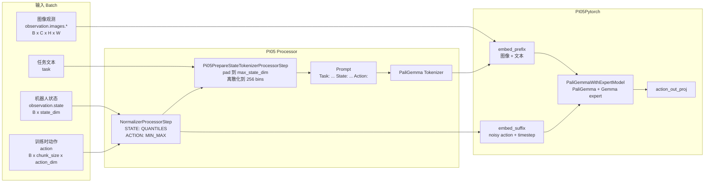

# PI0.5 模型结构分析

本文基于当前仓库中的 LeRobot PI0.5 实现整理，主要代码位于：

- `unitree_lerobot/lerobot/src/lerobot/policies/pi05/configuration_pi05.py`
- `unitree_lerobot/lerobot/src/lerobot/policies/pi05/processor_pi05.py`
- `unitree_lerobot/lerobot/src/lerobot/policies/pi05/modeling_pi05.py`
- `scripts/train_pi05_lora_g1_23_6d_20hz_experiment.sh`

## 1. 总体结构

PI0.5 在当前实现里由三层组成：

1. `PI05Config`：定义模型尺寸、动作 chunk、归一化、flow matching、LoRA 和优化器参数。
2. `make_pi05_pre_post_processors`：负责 LeRobot transition 到模型 batch 的转换，包括 state 离散化进 prompt。
3. `PI05Policy` / `PI05Pytorch`：负责图像预处理、动作 padding、训练 loss、推理采样和 action queue。

总览图：



完整 Mermaid 源码见 `docs/diagrams/pi05_overview.mmd`。

## 2. 关键配置

`PI05Config` 的核心默认值：

| 参数 | 默认值 | 作用 |
| --- | --- | --- |
| `paligemma_variant` | `gemma_2b` | PaliGemma language model 尺寸 |
| `action_expert_variant` | `gemma_300m` | 动作 expert 尺寸 |
| `chunk_size` | `50` | 一次预测的动作序列长度 |
| `n_action_steps` | `50` | 每次 chunk 中实际执行/入队的动作数 |
| `max_state_dim` | `32` | state padding 后维度 |
| `max_action_dim` | `32` | action padding 后维度 |
| `num_inference_steps` | `10` | flow matching 推理积分步数 |
| `image_resolution` | `(224, 224)` | PaliGemma/SigLIP 输入分辨率 |
| `lora_rank` | `0` | 0 表示关闭 LoRA |

Gemma 变体在 `get_gemma_config` 中定义：

| variant | width | depth | mlp_dim | heads | kv heads | head_dim |
| --- | ---: | ---: | ---: | ---: | ---: | ---: |
| `gemma_300m` | 1024 | 18 | 4096 | 8 | 1 | 256 |
| `gemma_2b` | 2048 | 18 | 16384 | 8 | 1 | 256 |

## 3. Processor 数据流

预处理 pipeline 顺序：

1. `RenameObservationsProcessorStep`
2. `AddBatchDimensionProcessorStep`
3. `NormalizerProcessorStep`
4. `Pi05PrepareStateTokenizerProcessorStep`
5. `TokenizerProcessorStep`
6. `DeviceProcessorStep`

其中 PI0.5 特有的是 `Pi05PrepareStateTokenizerProcessorStep`：

- 要求存在 `observation.state` 和 complementary data 里的 `task`。
- 先把 state padding 到 `max_state_dim`。
- 假设 state 已经被前面的 normalizer 归一化到 `[-1, 1]`。
- 用 256 个 bin 离散化 state。
- 拼接成 prompt：`Task: {task}, State: {discretized_state};\nAction: `。

这意味着 state 不作为单独 tensor 输入主干模型，而是被离散化后写进语言 prompt。

后处理 pipeline：

1. `UnnormalizerProcessorStep`
2. `DeviceProcessorStep(device="cpu")`

## 4. 模型主体

`PI05Pytorch` 内部包含：

- `PaliGemmaWithExpertModel`
  - `paligemma`: `PaliGemmaForConditionalGeneration`
  - `gemma_expert`: `GemmaForCausalLM`
- `action_in_proj`: `max_action_dim -> action_expert_width`
- `action_out_proj`: `action_expert_width -> max_action_dim`
- `time_mlp_in` / `time_mlp_out`: timestep embedding MLP

`PaliGemmaWithExpertModel.forward` 支持三种路径：

1. 只有 prefix：`inputs_embeds=[prefix_embs, None]`，走 PaliGemma language model，可生成 prefix cache。
2. 只有 suffix：`inputs_embeds=[None, suffix_embs]`，走 Gemma expert。
3. prefix + suffix：两个模型逐层联合 attention，训练时使用。

prefix 来自图像和语言：

- 图像先经 `paligemma.model.get_image_features`。
- 文本经 `paligemma.language_model.embed_tokens`。
- 图像和文本的 attention mask 都作为 prefix 区域处理。

suffix 来自动作和时间：

- `noisy_actions` 经 `action_in_proj`。
- `timestep` 经 sinusoidal embedding，再过 MLP。
- time embedding 作为 action expert 的 AdaRMS 条件。

## 5. 训练 forward

训练逻辑在 `PI05Policy.forward` 和 `PI05Pytorch.forward` 中：

1. `PI05Policy.forward` 预处理图像、读取语言 tokens、padding action。
2. `PI05Pytorch.forward` 采样噪声和时间。
3. 构造 flow matching 中间点：
   - `x_t = t * noise + (1 - t) * actions`
   - `u_t = noise - actions`
4. `embed_prefix` 编码图像和语言。
5. `embed_suffix` 编码 `x_t` 和 `timestep`。
6. prefix + suffix 一起进入 `PaliGemmaWithExpertModel.forward`。
7. 取 suffix 输出的最后 `chunk_size` 个 hidden states。
8. `action_out_proj` 预测 `v_t`。
9. 用 `MSE(u_t, v_t)` 作为 loss，并按真实 action 维度截断。

训练图源码见 `docs/diagrams/pi05_forward_train.mmd`。

## 6. 推理采样

推理入口有两个：

- `predict_action_chunk(batch)`：直接输出一个完整动作 chunk。
- `select_action(batch)`：如果 action queue 为空，就调用 `predict_action_chunk` 填队列，然后每次返回一个动作。

`sample_actions` 的流程：

1. 编码 prefix，并使用 `use_cache=True` 得到 `past_key_values`。
2. 初始化 `x_t = noise`，shape 为 `B x chunk_size x max_action_dim`。
3. 从 `flow_time = 1.0` 开始，以 `dt = -1 / num_inference_steps` 积分到 0。
4. 每一步调用 `denoise_step`：
   - 用当前 `x_t` 和 timestep 构造 suffix。
   - 复用 prefix cache。
   - 输出速度场 `v_t`。
5. 更新 `x_t = x_t + dt * v_t`。
6. 最终 `x_t` 截断到真实 action 维度并返回。

推理图源码见 `docs/diagrams/pi05_inference.mmd`。

## 7. LoRA 结构

LoRA 在 `PI05Policy.enable_lora` 中注入：

1. 先冻结所有 base 参数。
2. target modules：
   - `self_attn.q_proj`
   - `self_attn.k_proj`
   - `self_attn.v_proj`
   - `self_attn.o_proj`
   - `mlp.gate_proj`
   - `mlp.up_proj`
   - `mlp.down_proj`
3. 可分别注入：
   - `paligemma.language_model`
   - `gemma_expert`
4. 默认不对 vision tower 注入 LoRA。

当前训练脚本 `scripts/train_pi05_lora_g1_23_6d_20hz_experiment.sh` 使用：

```bash
--policy.type=pi05
--policy.lora_rank=16
--policy.lora_alpha=16
--policy.lora_dropout=0.05
--policy.gradient_checkpointing=...
```

LoRA/G1 适配图源码见 `docs/diagrams/pi05_lora_g1_adaptation.mmd`。

## 8. Unitree G1 适配要点

当前仓库中的 G1 任务一般把实际控制维度设为 6D、11D 或 13D 等，PI0.5 内部统一 padding 到 32 维：

- state：真实维度 -> `max_state_dim=32` -> 离散化进入 prompt。
- action：真实维度 -> `max_action_dim=32` -> 模型预测 32 维 -> 截断回真实维度。
- 图像：任意输入相机 feature -> resize/pad 到 `224 x 224` -> `[-1, 1]`。
- 任务文本：和离散 state 拼成 PI0.5 prompt。

因此，数据集 feature shape 和 `config.output_features[ACTION].shape[0]` 必须正确，否则训练 loss 截断和推理 unpad 会和机器人控制维度不一致。

## 9. 文件使用方式

Mermaid 源文件：

- `docs/diagrams/pi05_overview.mmd`
- `docs/diagrams/pi05_forward_train.mmd`
- `docs/diagrams/pi05_inference.mmd`
- `docs/diagrams/pi05_lora_g1_adaptation.mmd`

如果安装了 Mermaid CLI，可渲染为 SVG：

```bash
mmdc -i docs/diagrams/pi05_overview.mmd -o docs/diagrams/pi05_overview.svg
mmdc -i docs/diagrams/pi05_forward_train.mmd -o docs/diagrams/pi05_forward_train.svg
mmdc -i docs/diagrams/pi05_inference.mmd -o docs/diagrams/pi05_inference.svg
mmdc -i docs/diagrams/pi05_lora_g1_adaptation.mmd -o docs/diagrams/pi05_lora_g1_adaptation.svg
```

也可以直接把 `.mmd` 内容粘贴到 <https://mermaid.live>，或在支持 Mermaid 的 Markdown 预览器中打开本文档。
